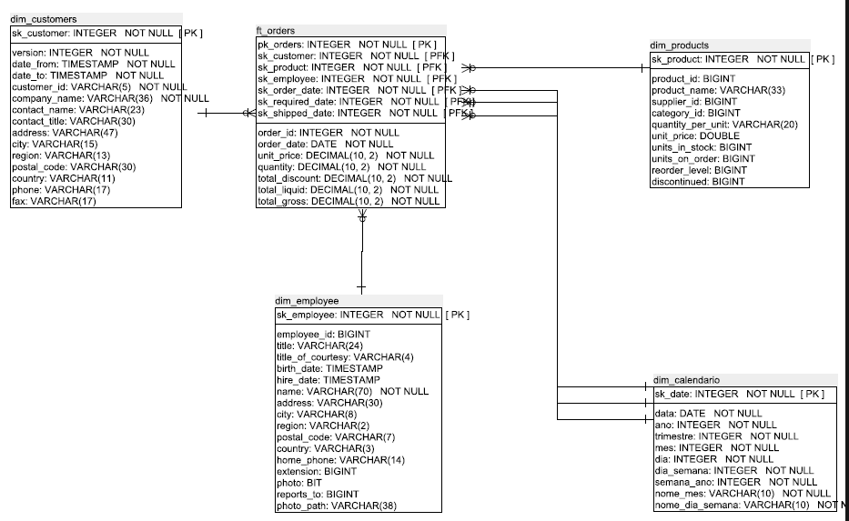
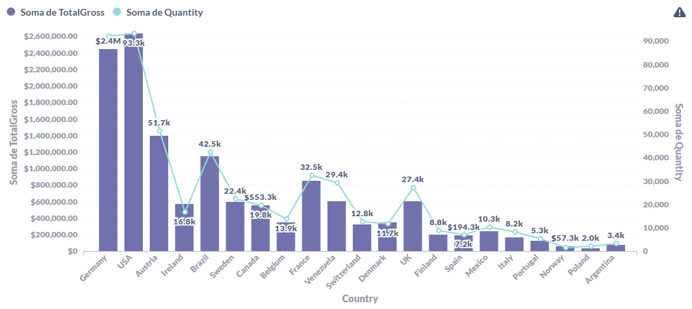
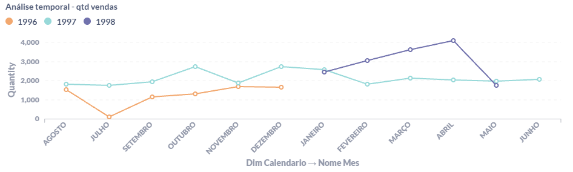

# 🏪 DW Retail

Projeto de Data Warehouse para análise de vendas no varejo, utilizando Apache Hop para os processos ETL, MySQL para armazenamento analítico e Metabase para visualização de indicadores e dashboards.

## 🎯 Objetivo

Consolidar dados operacionais em um Data Warehouse para apoiar a tomada de decisão através de análises e indicadores de negócio.

## 🛠 Tecnologias Utilizadas

- Apache Hop
- MySQL
- Metabase
- Data Warehouse
- ETL

## 📂 Estrutura do Projeto

```text
ETL/
├── stg/
├── DW/
└── workflow/
```

## 📊 Funcionalidades

- Extração de dados
- Transformação de dados
- Carga para Data Warehouse
- Dashboards no Metabase

## 📊 Modelo Dimensional

Modelo dimensional desenvolvido utilizando a abordagem Star Schema para análise de vendas.



### Estrutura Analítica

**Tabela Fato**

- ft_orders

**Dimensões**

- dim_customers
- dim_products
- dim_employee
- dim_calendario

### Arquivos Complementares

- [Modelo em PDF](docs/dw.pdf)
- [Modelo em HTML](docs/dw.html)

---

## 📈 Dashboards Metabase

### Quantidade Vendida por País

Análise comparativa entre faturamento e quantidade de produtos vendidos por país.



### Evolução Temporal das Vendas

Análise temporal da quantidade de vendas por período.



## 👨‍💻 Autor

Matheus Augusto